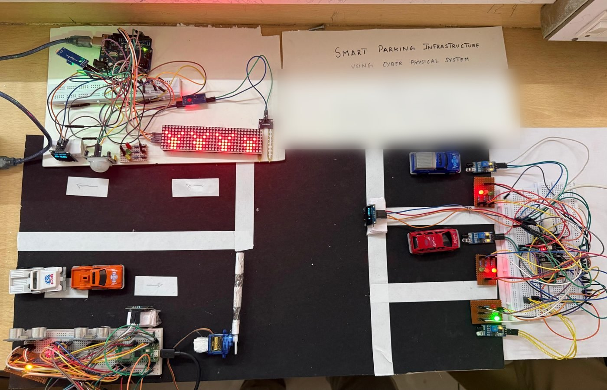
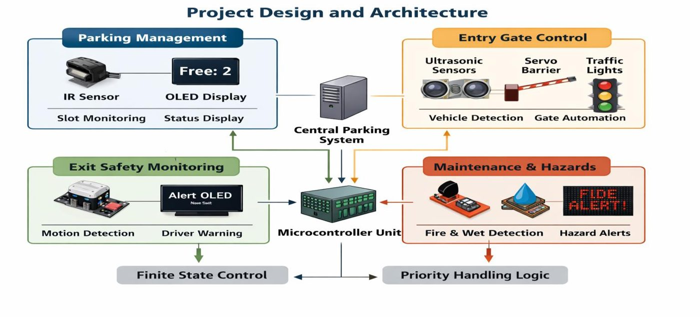
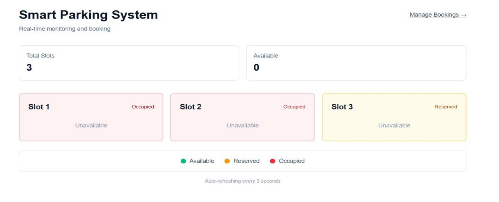
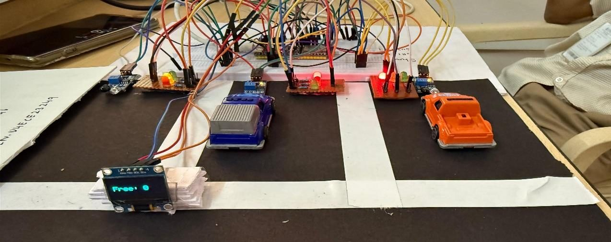
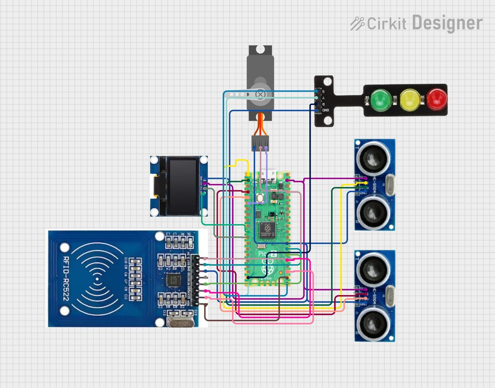
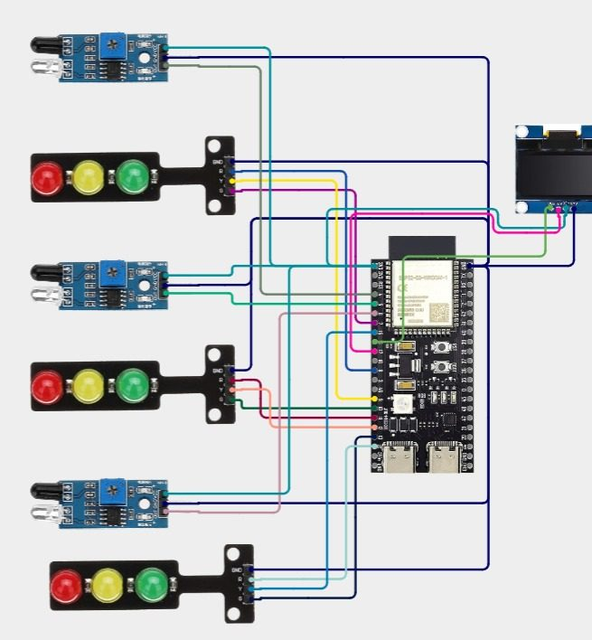
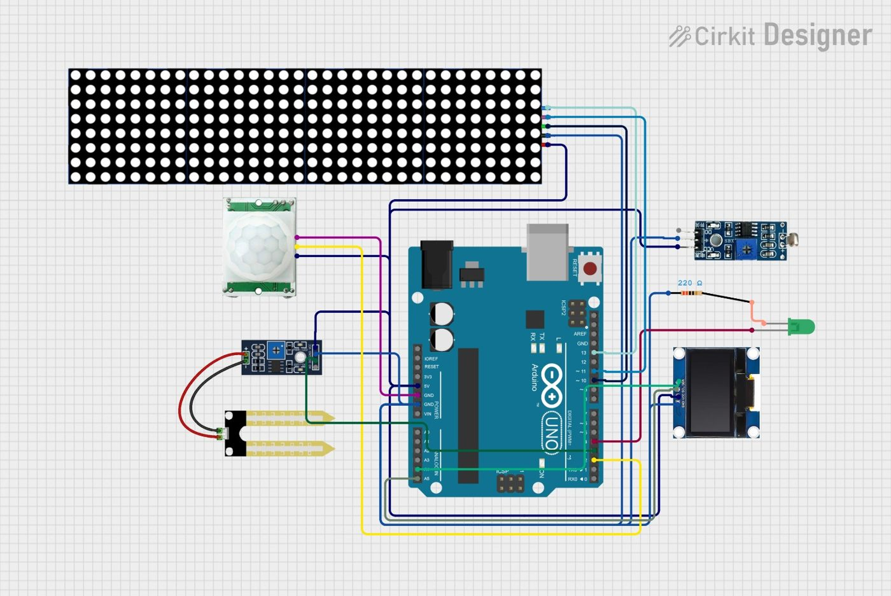
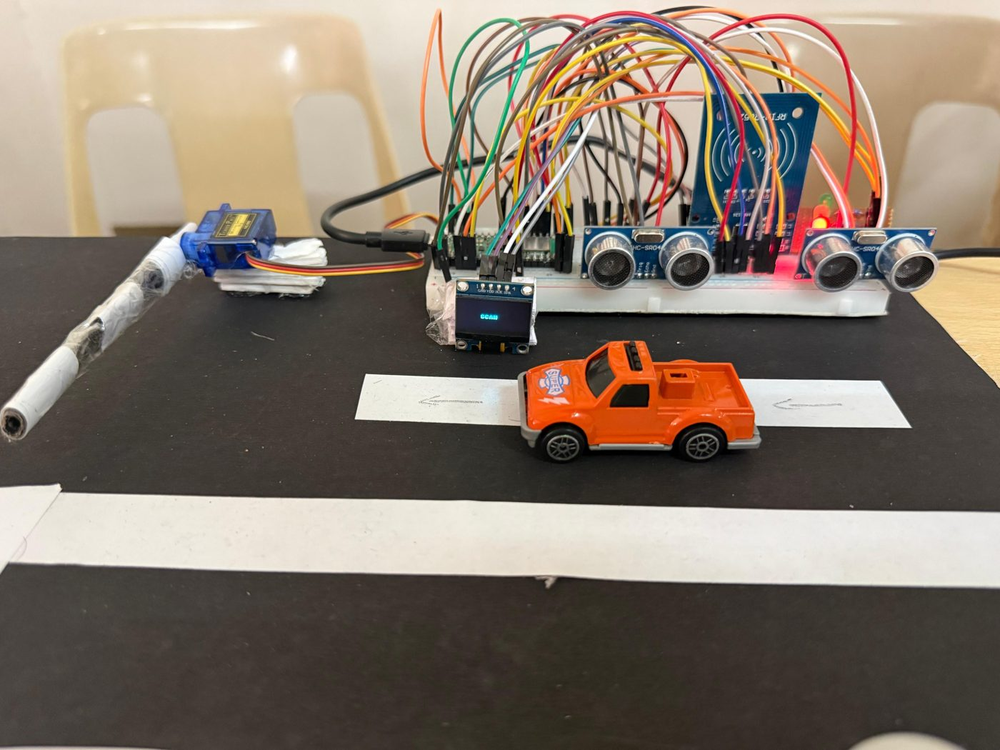
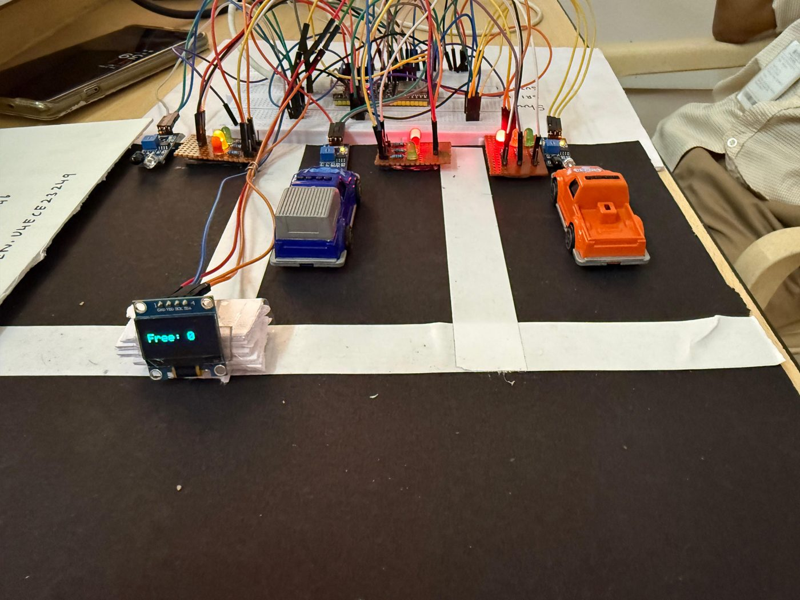
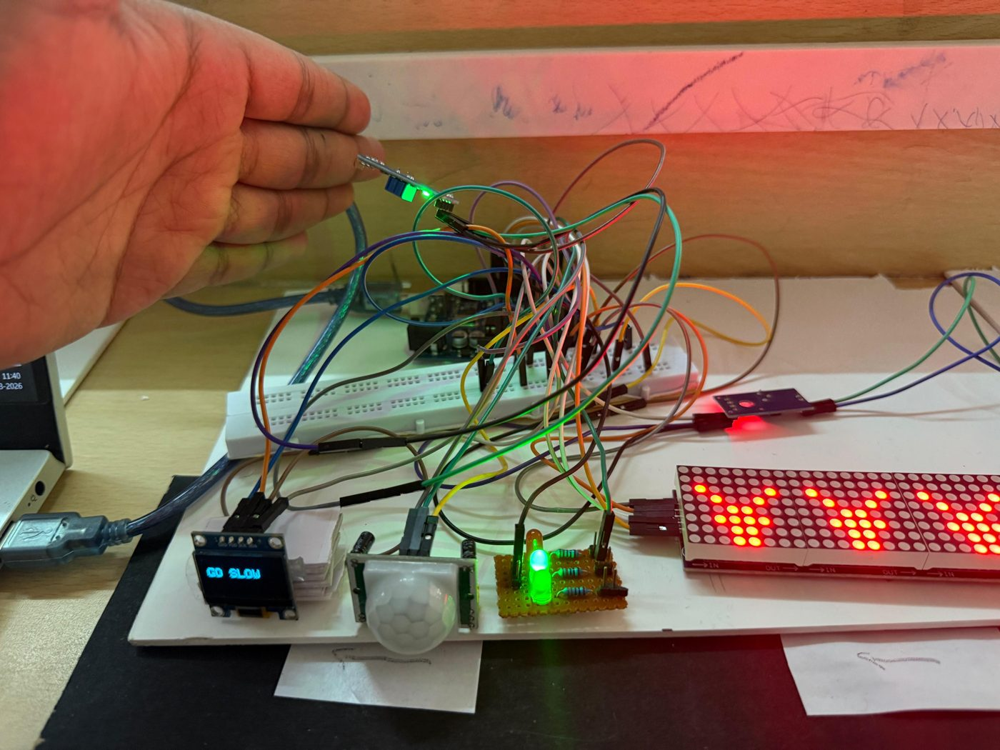

<h1 align="center">Smart Parking Infrastructure using Cyber-Physical Systems</h1>

<p align="center">
  An IoT smart parking system with RFID-controlled entry, live slot monitoring with cloud reservations, and exit-lane pedestrian and hazard alerts. It runs on three microcontrollers: <b>Raspberry Pi Pico</b>, <b>ESP32-S3</b> and <b>STM32</b>.
</p>

<p align="center">
  <a href="https://sujithpg-coder.github.io/smart-parking-cps/"></a>
</p>

<p align="center">
  
  
  
  
  
</p>

<p align="center">
  
</p>

---

## Overview

Cities have more cars every year. Parking that is monitored by hand wastes space, causes congestion and burns fuel while drivers search for a spot. This project builds a **cyber-physical parking system** in which sensors, embedded controllers, actuators and a web dashboard work together to:

- **Control entry:** detect the vehicle, check the driver's RFID card, and raise the barrier automatically
- **Track every slot:** show each slot as Free, Reserved or Occupied, with LEDs, an OLED counter and a web dashboard
- **Make the exit safer:** warn drivers about pedestrians, wet floors and low light

## System Architecture

<p align="center">
  
</p>

| Module | Controller | Sensors / actuators | Firmware |
|---|---|---|---|
| **Entry gate control** | Raspberry Pi Pico (RP2040) | 2 × HC-SR04 ultrasonic, MFRC522 RFID, SG90 servo barrier, traffic LEDs, SSD1306 OLED | [`firmware/entry-gate-pico/main.py`](firmware/entry-gate-pico/main.py) |
| **Parking slot monitoring** | ESP32-S3 | 3 × IR sensors, per-slot RGB status LEDs, SSD1306 OLED, Wi-Fi | [`firmware/parking-slots-esp32/`](firmware/parking-slots-esp32/Smart_Parking_System/Smart_Parking_System.ino) |
| **Exit safety and hazards** | STM32F4 | PIR motion, moisture sensor, LDR, MAX7219 8×8 LED matrix, SSD1306 OLED, exit light | [`firmware/exit-safety-stm32/exit_system.c`](firmware/exit-safety-stm32/exit_system.c) |
| **Web dashboard** | GitHub Pages | Slot status, reservations, API view | [`docs/index.html`](docs/index.html) |

## How It Works

### 1. Entry gate: finite state machine

```
 STOP ──vehicle detected──► SCAN ──valid RFID card──► GO ──vehicle clears──► STOP
   ▲                          │                                              
   └──vehicle leaves──────────┘          (unknown card → "DENIED", barrier stays down)
```

- An ultrasonic sensor detects a car at the barrier and the OLED asks for a card scan.
- An **authorised RFID card** raises the servo barrier. An unknown card shows **DENIED**.
- The barrier closes automatically once the car has passed. Traffic LEDs guide the driver.

### 2. Parking slots and cloud sync

- An IR sensor at each slot detects whether a car is parked there.
- Each slot's LED shows its state: 🟢 **free**, 🟡 **reserved** (booked from the dashboard), 🔴 **occupied**. A parked car clears its reservation.
- The OLED shows the number of free slots.
- Every 5 s the ESP32 downloads the slot list (`GET api/slots.json`) to pick up reservations. It can also upload occupancy changes (`POST /api/update-slot`) when a backend is set up.

### 3. Exit safety: priority-based alerts

| Priority | Condition | LED matrix | OLED message |
|:---:|---|---|---|
| 1 | Moisture sensor wet | Wet-floor pattern | `CAUTION! WET FLOOR` |
| 2 | PIR detects a pedestrian | Pedestrian pattern | `PEDESTRIAN AHEAD · SLOW DOWN` |
| 3 | LDR reads dark | Night pattern, exit light **on** | `LOW LIGHT · LIGHTS ON` |
| 4 | Normal | Normal pattern | `ALL CLEAR · DRIVE SAFE` |

## Web Dashboard

<p align="center">
  <a href="https://sujithpg-coder.github.io/smart-parking-cps/"><b>▶ Open the live demo</b></a>
</p>

The dashboard is hosted on **GitHub Pages**. It shows total, available, reserved and occupied slots, lets you **reserve or cancel** a slot, and shows the JSON that the ESP32 reads.

GitHub Pages only serves files and cannot receive data from devices. The hosted page is therefore a **demo with simulated sensors**: use the *Car arrives / leaves* buttons in place of the IR sensors. The ESP32 reads reservations from [`docs/api/slots.json`](docs/api/slots.json) on GitHub Pages. To upload live occupancy, set `apiUpdateSlotURL` to your own server and set `ENABLE_SLOT_UPLOAD 1` in the ESP32 sketch.

| Dashboard from the prototype | Matching hardware: 2 occupied, 1 reserved |
|:---:|:---:|
|  |  |

## Hardware

| Entry gate (Pico) | Parking slots (ESP32-S3) | Exit safety module |
|:---:|:---:|:---:|
|  |  |  |
|  |  |  |

### Bill of Materials

| Component | Qty | Component | Qty |
|---|:---:|---|:---:|
| Raspberry Pi Pico (RP2040) | 1 | MFRC522 RFID module + cards | 1 |
| ESP32-S3 dev board | 1 | SG90 servo motor | 1 |
| STM32F4 board | 1 | PIR sensor (HC-SR501) | 1 |
| IR obstacle sensors | 3 | Moisture sensor | 1 |
| HC-SR04 ultrasonic sensors | 2 | LDR | 1 |
| SSD1306 0.96" OLED | 3 | MAX7219 8×8 LED matrix | 1 |
| Red / yellow / green LED sets | 4 | 5 V regulated supply | 1 |

## Getting Started

**Entry gate (Raspberry Pi Pico)**
1. Flash MicroPython onto the Pico and open it in **Thonny**.
2. Copy the `ssd1306.py` and `mfrc522.py` driver modules onto the Pico.
3. Upload `firmware/entry-gate-pico/main.py` and add your card UIDs to `AUTHORIZED_CARDS`.

**Parking slots (ESP32-S3)**
1. In the Arduino IDE, install the **ESP32** board package and the **ArduinoJson**, **Adafruit GFX** and **Adafruit SSD1306** libraries.
2. Open `firmware/parking-slots-esp32/Smart_Parking_System/Smart_Parking_System.ino`.
3. Enter your Wi-Fi name and password, then upload.

**Exit safety (STM32)**
1. Create an STM32CubeIDE project for your STM32F4 board (developed for an STM32F401-class device).
2. Replace `main.c` with `firmware/exit-safety-stm32/exit_system.c`. It includes the clock, GPIO, ADC, SPI and I2C setup.
3. Build and flash. The code compiles and links cleanly with `arm-none-eabi-gcc` and the STM32F4 HAL.

## Repository Structure

```
smart-parking-cps/
├── firmware/
│   ├── entry-gate-pico/main.py                 # MicroPython: RFID + barrier FSM
│   ├── parking-slots-esp32/Smart_Parking_System/
│   │   └── Smart_Parking_System.ino            # Arduino: IR slots + cloud sync
│   └── exit-safety-stm32/exit_system.c         # STM32 HAL: PIR / moisture / LDR alerts
├── docs/
│   ├── index.html                              # Web dashboard (GitHub Pages)
│   ├── api/slots.json                          # Slot data read by the ESP32
│   └── images/
└── LICENSE
```

## Future Scope

Automatic number-plate recognition (ANPR) · mobile app for booking · a real-time backend for live occupancy · solar-powered nodes · multi-level parking with dynamic pricing

## Author

**Sujith Krishna P G**

<a href="https://github.com/SujithPG-coder"></a>
<a href="https://www.linkedin.com/in/sujithkrishnapg/"></a>

## License

This project is licensed under the [MIT License](LICENSE) © 2026 Sujith Krishna P G.
